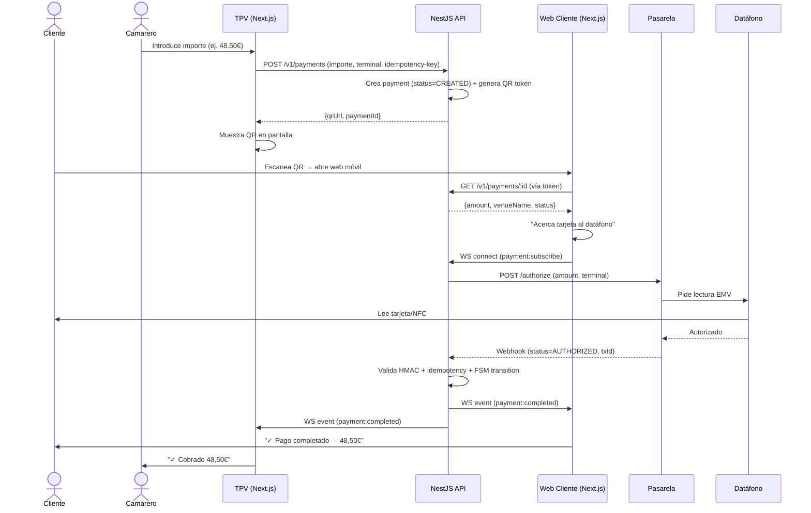
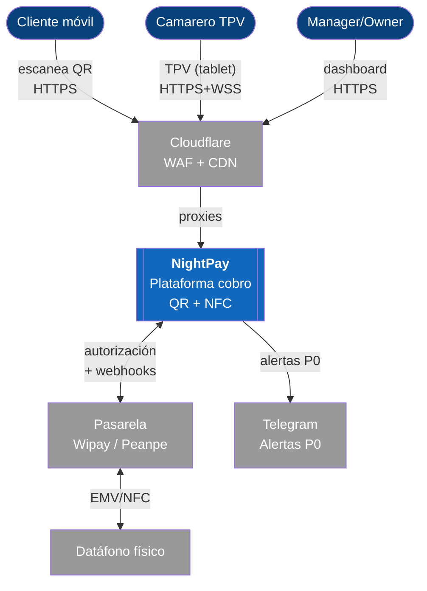
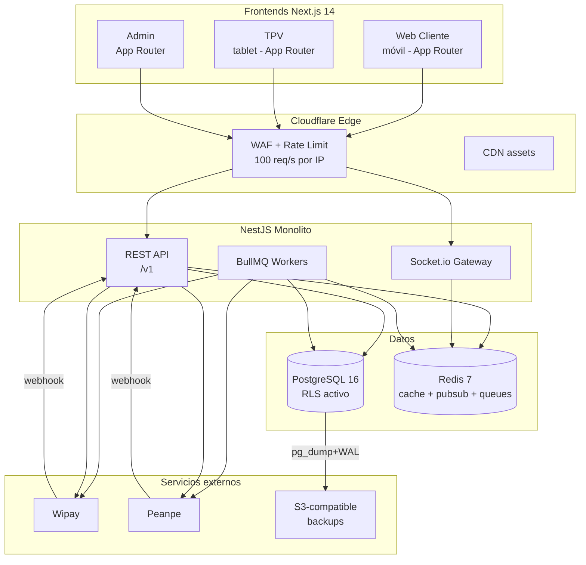
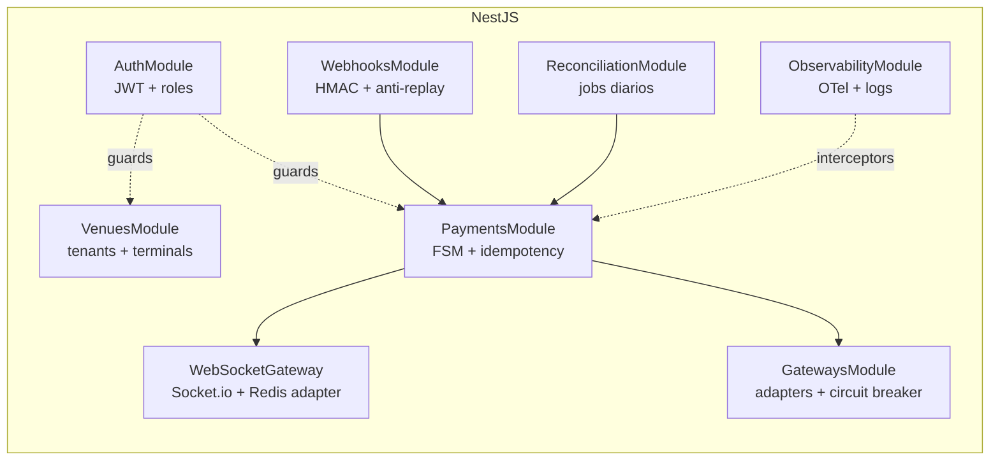
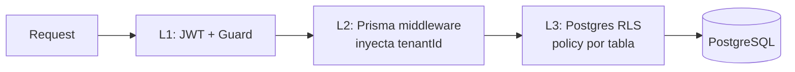
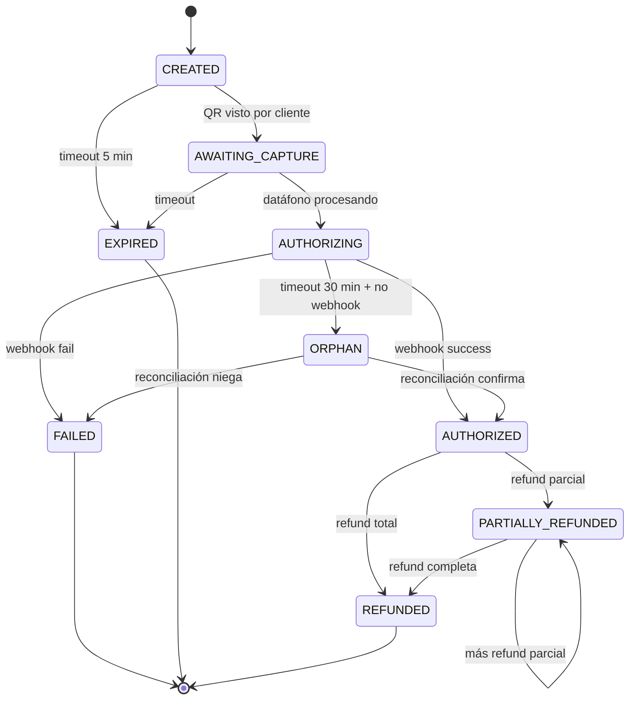

# NightPay — Documento Técnico Maestro v2

**Versión**: 2.0
**Estado**: Living document
**Audiencia**: Ingeniería, DevOps, Operaciones nocturnas
**Objetivo**: Que un ingeniero nuevo, con solo este documento y acceso al repo, pueda **levantar, operar y responder a incidentes** sin consultar a nadie.

---

## Índice

1. [Resumen ejecutivo](#1-resumen-ejecutivo)
2. [Requisitos funcionales y escenarios reales](#2-requisitos-funcionales-y-escenarios-reales)
3. [Arquitectura técnica](#3-arquitectura-técnica)
4. [Multi-tenancy (defensa en profundidad)](#4-multi-tenancy-defensa-en-profundidad)
5. [Modelo de datos](#5-modelo-de-datos)
6. [Backend NestJS](#6-backend-nestjs)
7. [Frontends Next.js](#7-frontends-nextjs)
8. [Pagos y orquestación](#8-pagos-y-orquestación)
9. [Colas y jobs](#9-colas-y-jobs)
10. [Realtime (Socket.io + Redis adapter)](#10-realtime-socketio--redis-adapter)
11. [Webhooks externos](#11-webhooks-externos)
12. [Observabilidad](#12-observabilidad)
13. [Resiliencia y caos](#13-resiliencia-y-caos)
14. [Testing](#14-testing)
15. [Despliegue e infraestructura](#15-despliegue-e-infraestructura)
16. [Runbooks operativos + Onboarding](#16-runbooks-operativos--onboarding)
17. [Roadmap 12 semanas revisado](#17-roadmap-12-semanas-revisado)
18. [Apéndices](#18-apéndices)

---

## 1. Resumen ejecutivo

*(Esta sección se escribe al final — es el último bloque del doc. Ver §17 primero.)*

### Visión en una frase
NightPay convierte el cobro en discotecas, festivales y bares de un trámite de 60–120s a una acción de **<15 segundos**: el cliente escanea un QR con su móvil, acerca tarjeta o móvil NFC al datáfono del local y paga. Cero formularios, cero fricción, cero pérdidas de venta en el cuello de botella del bar.

### Objetivos operativos (binarios)
- **Latencia de checkout p95 ≤ 15s** en horario 20:00–06:00
- **Disponibilidad ≥ 99.5%** mensual en ventana nocturna
- **Capacidad sostenida ≥ 300 TPS**, pico ≥ 500 TPS
- **Cero pagos duplicados** (idempotencia obligatoria)
- **Cero pagos atascados > 30 minutos** (auto-resolución + runbook)
- **RTO 1h / RPO 1h** ante incidente mayor
- **Reconciliación financiera diaria al 100%** (match con reportes de pasarela)

---

## 2. Requisitos funcionales y escenarios reales

### 2.1 Actores
| Actor | Descripción | Interfaz |
|-------|-------------|----------|
| **Cliente** | Consumidor final, móvil en mano, con alcohol, poca luz, ruido | Next.js móvil vía QR |
| **Camarero** | Opera TPV físico + datáfono, valida pago en pantalla | Next.js TPV (tablet) |
| **Manager** | Ve dashboard, aplica reembolsos, exporta reportes contables | Next.js admin |
| **Owner** | Ve consolidado multi-local, configura pasarelas y tarifas | Next.js admin (rol elevado) |
| **Pasarela** (Wipay, Peanpe) | Procesa pagos EMV, envía webhooks | Webhook firmado HMAC |
| **Datáfono** | Lee tarjeta/NFC físicamente, autoriza con banco | Webhook + consulta estado |

### 2.2 Flujo principal (happy path)



### 2.3 Escenarios reales no-happy-path (obligatorios)

Cada uno es un **test E2E + runbook** — no solo texto.

| # | Escenario | Disparador | Comportamiento esperado |
|---|-----------|------------|------------------------|
| E1 | **Pico salida concierto** | 500 TPS sostenidos durante 5 min a las 02:30 | API p95 < 800ms, sin errores 5xx, sin colas BullMQ >1000 |
| E2 | **Desconexión WS móvil** | Cliente bloquea móvil 30s durante pago | Al reconectar, GET `/v1/payments/:id` recupera estado real |
| E3 | **Pasarela ambigua** | Timeout 10s tras `POST /authorize` | Consulta `GET /status` antes de reintentar; nunca doble cobro |
| E4 | **Webhook desordenado** | `FAILED` llega antes que `AUTHORIZED` | FSM rechaza transición inválida; log warning |
| E5 | **Webhook duplicado** | Misma firma HMAC llega 3 veces | Idempotencia en event_id; procesa solo 1a vez |
| E6 | **Reembolso parcial** | Manager devuelve 12€ de pago de 48€ | Crea `refund` enlazado; reduce available_amount; emite webhook interno |
| E7 | **Reembolso total** | Cliente disputa pago de hace 2 días | Reversa completa en pasarela; marca payment como REFUNDED |
| E8 | **Cierre de caja** | Manager cierra día 06:00 | Dashboard muestra total cobrado/reembolsado/neto + export CSV |
| E9 | **Pago atascado >30min** | Pasarela no responde AUTHORIZED ni FAILED | Job reconciliación consulta `GET /status`, resuelve o marca ORPHAN |
| E10 | **Conciliación diaria** | 07:00 AM | Job compara `payment_events` locales vs export pasarela; alerta si gap |
| E11 | **QR expirado** | Cliente tarda >5 min en escanear | Web muestra "QR expirado — solicita nuevo"; TPV genera otro |
| E12 | **Red local cae** | Venue WiFi muere durante transacción | Datáfono retiene autorización; NightPay auto-recupera vía polling al volver |

### 2.4 Requisitos no funcionales

| Requisito | Objetivo | Método verificación |
|-----------|----------|---------------------|
| Latencia API p95 | < 500ms en steady state | k6 + Grafana p95 |
| Latencia WS end-to-end | < 300ms evento→UI | Playwright con timers |
| Throughput sostenido | ≥ 300 TPS 1h | k6 stress-test-sustained |
| Throughput pico | ≥ 500 TPS 5min | k6 stress-test-spike |
| Disponibilidad nocturna | 99.5% 20:00–06:00 | Uptime robot + Grafana |
| Recovery Time Objective | 1h | Drill trimestral |
| Recovery Point Objective | 1h | PITR validado en staging |
| Cero pérdida transaccional | 100% eventos persistidos | Reconciliación diaria |

### Criterios de aceptación verificables

- [ ] Los 12 escenarios E1–E12 tienen test E2E automatizado en `tests/e2e/`
- [ ] `k6 run scripts/spike-500tps.js` pasa sin degradar p95 > 800ms
- [ ] Cada escenario tiene un runbook en `docs/runbooks/` (si requiere intervención manual)
- [ ] Los 7 requisitos no funcionales tienen métrica en Grafana
- [ ] Tabla de actores 1:1 con roles en código (`@Roles('owner'|'manager'|'waiter')`)

---

## 3. Arquitectura técnica

### 3.1 Diagrama C4 — Contexto (nivel 1)



### 3.2 Diagrama C4 — Contenedores (nivel 2)



### 3.3 Diagrama C4 — Componentes del backend (nivel 3)



### 3.4 Principios arquitectónicos (innegociables)

1. **Monolito modular**, no microservicios — 1 dev, deploy atómico, coste bajo
2. **Multi-tenant con `tenant_id` + RLS** — defensa en profundidad (no solo app-layer)
3. **Event sourcing localizado en `payment_events`** — estado derivado de eventos; el resto de tablas son CRUD normal
4. **Idempotencia por diseño** — toda mutación crítica exige `Idempotency-Key`
5. **Dinero en céntimos (`Int`) siempre** — nunca `Float` / `Decimal` en JS
6. **Adapter pattern obligatorio** para pasarelas — cambiar proveedor = 1 clase nueva
7. **Socket.io con Redis adapter desde día 1** — no refactor futuro (ADR-001)
8. **Cloudflare al frente**: WAF + rate limit + DDoS shield + caché de assets

### 3.5 Stack tecnológico (bloqueado)

| Capa | Tecnología | Versión | Notas |
|------|-----------|---------|-------|
| Runtime | Node.js | 20 LTS | pinned en `.nvmrc` |
| Lenguaje | TypeScript | 5.x | `strict: true` innegociable |
| Frontend | Next.js | 14 | App Router, Server Components donde tenga sentido |
| UI lib | TailwindCSS + shadcn/ui | latest | velocidad dev |
| Backend | NestJS | 10 | fastify adapter (perf > express) |
| ORM | Prisma | 5 | + `@prisma/client` generated |
| Validación runtime | Zod | 3 | schemas compartidos FE/BE |
| DB | PostgreSQL | 16 | RLS activo |
| Cache/PubSub/Queue | Redis | 7 | BullMQ + Socket.io adapter |
| FSM | XState | 5 | pagos |
| Monorepo | pnpm workspaces + Turborepo | - | - |
| Container | Docker | 26+ | compose dev, Coolify prod |
| Hosting | Hetzner VPS CPX31 | - | 4 vCPU / 8GB / 160GB |
| Edge | Cloudflare | Free tier → Pro si necesario | - |
| Observability | OpenTelemetry + Grafana Cloud | - | free tier suficiente inicialmente |

### Criterios de aceptación verificables

- [ ] Los 3 diagramas C4 renderizan correctamente en GitHub/Obsidian
- [ ] `docker compose up` levanta **todos** los contenedores en <30s
- [ ] `pnpm tsc --noEmit` pasa en todo el monorepo sin errores
- [ ] Swap de pasarela (Wipay ↔ Peanpe) no requiere tocar `PaymentsModule`
- [ ] Cloudflare WAF activo con regla "rate limit 100 req/s por IP en `/v1/payments`"

---

## 4. Multi-tenancy (defensa en profundidad)

### 4.1 Modelo conceptual

```
Tenant (Venue = discoteca/bar/festival)
  ├── Users (owner, manager, waiter)
  ├── Terminals (datáfonos físicos)
  ├── GatewayCredentials (cifradas AES-256-GCM)
  ├── Payments
  │     └── PaymentEvents
  └── Refunds
```

Un `tenant_id` (= `venue_id`) atraviesa **todas** las tablas de dominio. Nada se consulta sin él.

### 4.2 Tres capas de aislamiento



**L1 — JWT/Guard**: `tenant_id` va firmado en el JWT. Un `@TenantGuard` lo extrae y lo mete en el request context (AsyncLocalStorage).

**L2 — Prisma middleware**: intercepta **toda** query y añade `WHERE tenant_id = ?` automáticamente. Si una query no tiene `tenantId` → throw en dev, log warning + reject en prod.

**L3 — Postgres RLS**: última línea. Aunque L1/L2 fallen por bug, RLS impide leer filas ajenas.

```sql
-- Ejemplo policy (aplicada en migración Prisma raw SQL)
ALTER TABLE payments ENABLE ROW LEVEL SECURITY;

CREATE POLICY tenant_isolation ON payments
  USING (tenant_id = current_setting('app.current_tenant_id')::uuid);
```

El backend setea `SET LOCAL app.current_tenant_id = '...'` al inicio de cada transacción (vía Prisma `$executeRaw` en interceptor global).

### 4.3 Roles y permisos

```typescript
enum Role {
  OWNER,    // ve todos sus venues, configura pasarelas, exporta
  MANAGER,  // 1 venue, reembolsos, dashboard
  WAITER,   // 1 venue, solo crea cobros y ve su terminal
}
```

Matriz mínima:
| Acción | OWNER | MANAGER | WAITER |
|--------|:-----:|:-------:|:------:|
| Crear pago | ✓ | ✓ | ✓ |
| Ver historial venue | ✓ | ✓ | solo hoy |
| Reembolso ≤100€ | ✓ | ✓ | ✗ |
| Reembolso >100€ | ✓ | 2FA | ✗ |
| Cambiar pasarela | ✓ | ✗ | ✗ |
| Ver cross-venue | ✓ | ✗ | ✗ |
| Export CSV | ✓ | ✓ | ✗ |

### 4.4 Cross-tenant leakage tests (obligatorio)

Test E2E en Playwright que ejecuta en CI:
1. Login como manager de venue A
2. Intenta `GET /v1/payments/{id_de_venue_B}` → debe devolver 404 (no 403, para no revelar existencia)
3. Inyecta JWT con `tenant_id` alterado manualmente → RLS rechaza a nivel DB

### Criterios de aceptación verificables

- [ ] RLS habilitado en las 8 tablas con `tenant_id` (verificable con `SELECT relrowsecurity FROM pg_class`)
- [ ] Prisma middleware emite log + reject si detecta query sin `tenantId` filter
- [ ] Test cross-tenant devuelve 404 y log con severidad WARN
- [ ] JWT manipulado manualmente con `tenant_id` de otro venue → RLS bloquea a nivel DB (test de integración)
- [ ] Manager no puede invocar `PUT /v1/venues/:id/gateway` aunque sea dueño del venue (solo OWNER)

---

## 5. Modelo de datos

### 5.1 Principios

- **Dinero**: siempre `Int` en céntimos. Tipo Prisma `Int` (4 bytes, máx ~21M €, suficiente)
- **UUIDs**: `@default(dbgenerated("gen_random_uuid()"))` (Postgres 13+)
- **Timestamps**: todo `DateTime @db.Timestamptz` (UTC)
- **Soft deletes**: solo donde aporta (`venues`, `users`); resto hard delete
- **`payment_events` es append-only**: sin `UPDATE`, sin `DELETE` (RLS + trigger prohíbe)
- **Particionado**: `payment_events` particionada por mes (RANGE partitioning)

### 5.2 Schema Prisma (extracto crítico)

```prisma
// prisma/schema.prisma
generator client {
  provider = "prisma-client-js"
}

datasource db {
  provider = "postgresql"
  url      = env("DATABASE_URL")
}

model Venue {
  id          String   @id @default(dbgenerated("gen_random_uuid()")) @db.Uuid
  name        String
  slug        String   @unique
  timezone    String   @default("Europe/Madrid")
  createdAt   DateTime @default(now()) @db.Timestamptz
  updatedAt   DateTime @updatedAt @db.Timestamptz
  deletedAt   DateTime? @db.Timestamptz

  users               User[]
  terminals           Terminal[]
  gatewayCredentials  GatewayCredential[]
  payments            Payment[]

  @@map("venues")
}

model User {
  id        String   @id @default(dbgenerated("gen_random_uuid()")) @db.Uuid
  tenantId  String   @db.Uuid
  email     String   @unique
  passwordHash String
  role      Role
  totpSecret String?                 // para 2FA en reembolsos altos
  createdAt DateTime @default(now()) @db.Timestamptz
  deletedAt DateTime? @db.Timestamptz

  venue     Venue    @relation(fields: [tenantId], references: [id])

  @@index([tenantId])
  @@map("users")
}

enum Role { OWNER MANAGER WAITER }

model Terminal {
  id         String   @id @default(dbgenerated("gen_random_uuid()")) @db.Uuid
  tenantId   String   @db.Uuid
  externalId String                  // ID que la pasarela conoce
  label      String                  // "Barra 1", "Pista central"
  active     Boolean  @default(true)

  venue      Venue    @relation(fields: [tenantId], references: [id])
  payments   Payment[]

  @@unique([tenantId, externalId])
  @@index([tenantId])
  @@map("terminals")
}

model GatewayCredential {
  id         String   @id @default(dbgenerated("gen_random_uuid()")) @db.Uuid
  tenantId   String   @db.Uuid
  provider   Provider
  // Credenciales cifradas AES-256-GCM con DEK rotable
  encKey     Bytes                   // ciphertext
  encNonce   Bytes
  encTag     Bytes
  kekVersion Int                     // para rotación
  active     Boolean  @default(true)
  createdAt  DateTime @default(now()) @db.Timestamptz

  venue      Venue    @relation(fields: [tenantId], references: [id])

  @@unique([tenantId, provider, active])
  @@map("gateway_credentials")
}

enum Provider { WIPAY PEANPE }

model Payment {
  id              String   @id @default(dbgenerated("gen_random_uuid()")) @db.Uuid
  tenantId        String   @db.Uuid
  terminalId      String   @db.Uuid
  idempotencyKey  String
  amountCents     Int
  currency        String   @default("EUR") @db.Char(3)
  status          PaymentStatus
  provider        Provider?
  providerTxId    String?
  qrToken         String   @unique
  qrExpiresAt     DateTime @db.Timestamptz
  availableAmountCents Int                        // disminuye con refunds
  createdAt       DateTime @default(now()) @db.Timestamptz
  updatedAt       DateTime @updatedAt @db.Timestamptz

  venue           Venue    @relation(fields: [tenantId], references: [id])
  terminal        Terminal @relation(fields: [terminalId], references: [id])
  events          PaymentEvent[]
  refunds         Refund[]

  @@unique([tenantId, idempotencyKey])
  @@index([tenantId, status])
  @@index([tenantId, createdAt(sort: Desc)])
  @@index([providerTxId])
  @@index([qrExpiresAt])                           // job expiración
  @@map("payments")
}

enum PaymentStatus {
  CREATED
  AWAITING_CAPTURE        // QR emitido, esperando cliente
  AUTHORIZING             // pasarela procesando
  AUTHORIZED              // terminal: éxito
  FAILED                  // terminal: fallo
  EXPIRED                 // QR expiró sin captura
  REFUNDED
  PARTIALLY_REFUNDED
  ORPHAN                  // incoherencia — requiere intervención
}

model PaymentEvent {
  id          BigInt   @id @default(autoincrement())
  paymentId   String   @db.Uuid
  tenantId    String   @db.Uuid
  eventType   String                              // payment.created, payment.authorized, ...
  payload     Json
  traceId     String                              // correlación OTel
  occurredAt  DateTime @default(now()) @db.Timestamptz

  payment     Payment  @relation(fields: [paymentId], references: [id])

  @@index([paymentId])
  @@index([tenantId, occurredAt(sort: Desc)])
  @@index([traceId])
  @@map("payment_events")
}

model Refund {
  id             String   @id @default(dbgenerated("gen_random_uuid()")) @db.Uuid
  tenantId       String   @db.Uuid
  paymentId      String   @db.Uuid
  amountCents    Int
  reason         String?
  requestedBy    String   @db.Uuid                // user.id
  status         RefundStatus
  providerRefundId String?
  createdAt      DateTime @default(now()) @db.Timestamptz

  payment        Payment  @relation(fields: [paymentId], references: [id])

  @@index([tenantId, paymentId])
  @@map("refunds")
}

enum RefundStatus { PENDING SUCCEEDED FAILED }

model WebhookDelivery {
  id          BigInt   @id @default(autoincrement())
  provider    Provider
  externalEventId String
  rawBody     Bytes
  signature   String
  processedAt DateTime? @db.Timestamptz
  tenantId    String?   @db.Uuid

  @@unique([provider, externalEventId])           // idempotencia de webhooks
  @@index([processedAt])
  @@map("webhook_deliveries")
}

model Reconciliation {
  id          String   @id @default(dbgenerated("gen_random_uuid()")) @db.Uuid
  tenantId    String   @db.Uuid
  provider    Provider
  day         DateTime @db.Date
  localTotalCents  Int
  gatewayTotalCents Int
  diffCents        Int
  status      ReconStatus
  discrepancies Json?
  runAt       DateTime @default(now()) @db.Timestamptz

  @@unique([tenantId, provider, day])
  @@index([status])
  @@map("reconciliations")
}

enum ReconStatus { OK MISMATCH PARTIAL }
```

### 5.3 Particionado de `payment_events`

Con 500 TPS pico, en 1 mes se generan ~10M filas. Consultas puntuales (hoy, semana) serían lentas sin particionado.

**Estrategia**: particionado declarativo Postgres 16 por RANGE en `occurred_at`.

```sql
-- migración (Prisma no soporta particiones nativamente — SQL raw en migration)
CREATE TABLE payment_events (
  id          BIGSERIAL,
  payment_id  UUID NOT NULL,
  tenant_id   UUID NOT NULL,
  event_type  TEXT NOT NULL,
  payload     JSONB NOT NULL,
  trace_id    TEXT NOT NULL,
  occurred_at TIMESTAMPTZ NOT NULL DEFAULT NOW(),
  PRIMARY KEY (id, occurred_at)
) PARTITION BY RANGE (occurred_at);

-- Particiones mensuales (creadas automáticamente por pg_partman)
CREATE TABLE payment_events_2026_01 PARTITION OF payment_events
  FOR VALUES FROM ('2026-01-01') TO ('2026-02-01');
-- ... 12 particiones precargadas
```

**`pg_partman`** mantiene particiones automáticamente (crea +4 meses futuros, archiva >13 meses a cold storage).

### 5.4 Índices críticos

```sql
-- Consultas más frecuentes y sus índices
-- 1. "Dame los últimos 50 pagos de este venue" (dashboard admin)
CREATE INDEX idx_payments_tenant_created ON payments (tenant_id, created_at DESC);

-- 2. "Encuentra pago por QR token" (cliente escanea)
-- Ya cubierto por @unique en schema

-- 3. "Pagos que expiran en los próximos 60s" (BullMQ job)
CREATE INDEX idx_payments_qr_expires ON payments (qr_expires_at)
  WHERE status IN ('CREATED', 'AWAITING_CAPTURE');

-- 4. "Eventos del pago X" (detalle UI)
CREATE INDEX idx_events_payment ON payment_events (payment_id);

-- 5. "Reconciliación: todos los eventos AUTHORIZED del día"
CREATE INDEX idx_events_tenant_type_occurred
  ON payment_events (tenant_id, event_type, occurred_at)
  WHERE event_type = 'payment.authorized';
```

### 5.5 Backups y PITR

- **Base backup diario** (pgBackRest o `pg_basebackup`) → S3 cifrado
- **WAL archiving cada 5 min** → S3 (RPO efectivo 5 min, no 1h)
- **Retención**: 30 días backups completos, 1 año WAL
- **Drill de restore trimestral**: levantar staging desde backup + WAL, validar con `SELECT COUNT(*)` vs prod, timing cronometrado
- **Script documentado**: `docs/runbooks/disaster-recovery-restore.md`

### 5.6 Migraciones zero-downtime

Regla: **ninguna migración bloquea por más de 2s**.

**Checklist pre-migración:**
1. ¿Añade columna `NOT NULL` sin default? → 2-phase: (a) nullable con default, (b) backfill, (c) set NOT NULL
2. ¿Rename de columna? → 2-phase: añadir nueva, copiar en app, backfill, eliminar vieja en release N+1
3. ¿Elimina columna? → 3-phase: deprecar en app, release + 1 semana, drop
4. ¿Añade índice? → `CREATE INDEX CONCURRENTLY` (Prisma: SQL raw en migration)
5. ¿Cambia tipo de columna? → columna nueva + backfill + swap

Cada migración pasa por `pg_migrate_dryrun` en staging con volumen prod simulado antes de merge.

### Criterios de aceptación verificables

- [ ] `pnpm prisma migrate dev` genera schema sin warnings
- [ ] Todas las tablas con `tenant_id` tienen RLS activo (test SQL automatizado)
- [ ] `payment_events` particionada en 12 meses precargados + job pg_partman corriendo
- [ ] PITR drill en staging: restore a timestamp arbitrario en <1h
- [ ] Los 5 índices de §5.4 existen (verificable vía `pg_indexes`)
- [ ] Migración con `CREATE INDEX CONCURRENTLY` se ejecuta en <2s sobre tabla con 10M filas

---

## 6. Backend NestJS

### 6.1 Estructura monorepo

```
nightpay/
├── apps/
│   ├── api/               # NestJS (Fastify adapter)
│   ├── web-client/        # Next.js — cliente móvil
│   ├── tpv/               # Next.js — TPV camarero
│   └── admin/             # Next.js — dashboard
├── packages/
│   ├── contracts/         # Zod schemas compartidos + tipos TS
│   ├── ui/                # shadcn/ui + componentes compartidos
│   ├── config/            # tsconfig base, eslint, prettier
│   └── db/                # Prisma schema + client generado + seeds
├── docker-compose.yml
├── turbo.json
└── pnpm-workspace.yaml
```

### 6.2 Módulos NestJS (por dominio)

```
apps/api/src/
├── main.ts
├── app.module.ts
├── modules/
│   ├── auth/                      # login, JWT, guards, 2FA TOTP
│   ├── venues/                    # tenants y terminals
│   ├── payments/                  # CRUD + FSM + idempotency
│   ├── gateways/                  # adapter Wipay, Peanpe + circuit breaker
│   ├── webhooks/                  # recepción externa + HMAC
│   ├── realtime/                  # Socket.io gateway + Redis adapter
│   ├── reconciliation/            # jobs diarios
│   ├── refunds/                   # reembolsos + 2FA para >100€
│   └── admin/                     # export CSV, métricas
├── common/
│   ├── guards/                    # AuthGuard, RolesGuard, TenantGuard
│   ├── interceptors/              # Logging, Tracing, Tenant
│   ├── pipes/                     # ZodValidationPipe
│   ├── filters/                   # AllExceptionsFilter
│   ├── decorators/                # @CurrentUser, @Tenant, @Idempotent
│   └── middleware/                # helmet, compression, rate-limit
└── config/
    ├── env.ts                     # zod-validated process.env
    └── bootstrap.ts
```

### 6.3 Patrones obligatorios

**Validación con Zod**: todo body/query/param pasa por Zod antes de tocar controller.

```typescript
// packages/contracts/src/payments.ts
import { z } from 'zod';
export const CreatePaymentSchema = z.object({
  amountCents: z.number().int().positive().max(10_000_00),
  terminalId: z.string().uuid(),
});
export type CreatePaymentDto = z.infer<typeof CreatePaymentSchema>;
```

**Idempotency decorator**:

```typescript
@Post()
@Idempotent({ ttl: 24 * 3600 })   // key = header Idempotency-Key, store en Redis
@UseGuards(AuthGuard, RolesGuard, TenantGuard)
@Roles('owner', 'manager', 'waiter')
async createPayment(
  @Tenant() tenantId: string,
  @Body(new ZodPipe(CreatePaymentSchema)) dto: CreatePaymentDto,
) { /* ... */ }
```

**Error handling centralizado**: `AllExceptionsFilter` convierte todo a `ProblemDetails` (RFC 7807).

```json
{
  "type": "about:blank",
  "title": "Validation failed",
  "status": 422,
  "detail": "amountCents must be positive",
  "instance": "/v1/payments",
  "traceId": "abc123"
}
```

**Tenant context** vía `AsyncLocalStorage`:

```typescript
// interceptor que antes de cada request:
const tenantId = req.user.tenantId;
this.als.run({ tenantId }, () => next.handle());

// luego en Prisma middleware:
prisma.$use(async (params, next) => {
  const ctx = als.getStore();
  if (ctx?.tenantId && params.args?.where) {
    params.args.where.tenantId = ctx.tenantId;
  }
  return next(params);
});
```

### 6.4 Versionado de API

- Prefijo de ruta: `/v1/...`
- Breaking changes → nuevo `/v2/...` coexiste 3 meses antes de deprecar `/v1`
- Header `Sunset: Wed, 11 Nov 2026 23:59:59 GMT` en respuestas de `/v1` durante período deprecación
- Changelog público en `CHANGELOG.md` con notación semver para contratos

### 6.5 Configuración y secretos

- Todo `process.env` validado con Zod al arrancar (`config/env.ts`) → fail-fast si falta
- Secretos nunca en .env committed. En dev: `.env.local` gitignored. En prod: Coolify env vars (encrypted at rest)
- Rotación de DB password cada 90 días (drill automatizado con rolling connection pool)
- DEK (Data Encryption Key) de credenciales de pasarela: rotación anual con re-encrypt job

### Criterios de aceptación verificables

- [ ] `pnpm --filter api start:dev` arranca API en <3s
- [ ] Un endpoint sin `@UseGuards(AuthGuard, TenantGuard)` falla build lint custom
- [ ] Body inválido devuelve 422 + Problem Details con `traceId`
- [ ] `curl -H "Idempotency-Key: X" -d {...}` dos veces crea un solo pago
- [ ] Log de error incluye `traceId` correlable con span OTel en Grafana

---

## 7. Frontends Next.js

### 7.1 Tres apps, un diseño

| App | URL | Usuario | Auth | Offline mode |
|-----|-----|---------|------|--------------|
| `web-client` | `pay.nightpay.app` | Cliente final anónimo | Token en QR (JWT corto) | PWA + cache de estado |
| `tpv` | `tpv.nightpay.app` | Camarero | Magic link + device fingerprint | Cola local de pagos pendientes |
| `admin` | `app.nightpay.app` | Manager/Owner | Email+password + 2FA | N/A |

### 7.2 App Router — convenciones

- **Server Components por defecto**; "use client" solo donde haya interactividad/estado
- Data fetching en Server Components con `fetch` + `next: { revalidate: N }` o `tags` para revalidación selectiva
- Mutaciones críticas (crear pago, reembolsar) pasan por **Server Actions** con validación Zod redundante
- Estado cliente con **Zustand** (ligero, sin boilerplate) + **TanStack Query** para server state

### 7.3 Shared types package (`packages/contracts`)

```typescript
// exportado y consumido tanto por API como frontends
export const PaymentDto = z.object({ /* ... */ });
export type PaymentDto = z.infer<typeof PaymentDto>;
export const PaymentEvents = z.discriminatedUnion('type', [
  z.object({ type: z.literal('payment.created'), /* ... */ }),
  z.object({ type: z.literal('payment.authorized'), /* ... */ }),
]);
```

→ Si API cambia un contrato y frontend no se actualiza, TS build falla en CI.

### 7.4 Realtime hook (compartido)

```typescript
// packages/ui/hooks/usePaymentRealtime.ts
export function usePaymentRealtime(paymentId: string) {
  const [status, setStatus] = useState<PaymentStatus>();
  const [wsDown, setWsDown] = useState(false);

  useEffect(() => {
    const socket = io(WS_URL, { auth: { token } });
    socket.emit('payment:subscribe', paymentId);
    socket.on('payment:update', (e) => setStatus(e.status));
    socket.on('disconnect', () => setWsDown(true));
    socket.on('connect', () => setWsDown(false));
    return () => { socket.disconnect(); };
  }, [paymentId]);

  // Fallback: si WS cae, polling cada 3s
  useEffect(() => {
    if (!wsDown) return;
    const t = setInterval(async () => {
      const p = await fetch(`/api/v1/payments/${paymentId}`).then(r => r.json());
      setStatus(p.status);
    }, 3000);
    return () => clearInterval(t);
  }, [wsDown, paymentId]);

  return { status, wsDown };
}
```

### 7.5 UX crítica del cliente móvil

- **1 pantalla, 1 acción**: "Acerca tarjeta al datáfono"
- Estados visibles: `CREATED` → `AWAITING` (spinner) → `AUTHORIZED` (check verde, haptic) / `FAILED` (rojo + botón "Reintentar")
- Al entrar: precheck conectividad (`navigator.onLine`). Si offline → "Sin conexión — espera a reconectar automáticamente"
- **Wake lock** (`navigator.wakeLock.request('screen')`) durante pago para que la pantalla no se apague
- Fuente grande (≥18px), alto contraste (dark default — pensado para discoteca)

### 7.6 TPV (tablet)

- **QR gigante en pantalla** (min 300×300px)
- Cola local IndexedDB de pagos creados offline; sincroniza al recuperar red
- Sonido al completarse pago (cowbell corto) — audible en ambiente ruidoso
- Botón "Cancelar QR" que emite cancelación → server marca `CANCELLED`

### 7.7 Admin dashboard

- Métricas en vivo (TPS actual, transacciones hoy, importe neto, errores)
- Filtros por fecha/terminal/estado
- Acción "Reembolsar" con modal 2FA si >100€
- Export CSV/Excel (server-side, stream para >10k filas)

### Criterios de aceptación verificables

- [ ] Los 3 frontends builden con `pnpm build` sin warnings
- [ ] Cambio de contrato en `packages/contracts` rompe TS en los 3 apps hasta actualizar
- [ ] Playwright: cliente móvil completa pago happy path en <15s
- [ ] Playwright: WS cae → tras 3s polling sincroniza estado
- [ ] Admin: reembolso >100€ exige código TOTP (test automatizado)

---

## 8. Pagos y orquestación

### 8.1 Máquina de estados (XState)



Implementado con **XState 5** — transiciones declarativas y testables:

```typescript
import { setup, createActor } from 'xstate';

const paymentMachine = setup({
  types: {
    context: {} as { paymentId: string; amountCents: number; providerTxId?: string },
    events: {} as
      | { type: 'QR_VIEWED' }
      | { type: 'AUTHORIZING' }
      | { type: 'AUTHORIZED'; providerTxId: string }
      | { type: 'FAILED'; reason: string }
      | { type: 'TIMEOUT' }
      | { type: 'REFUND_PARTIAL'; amountCents: number }
      | { type: 'REFUND_FULL' },
  },
}).createMachine({
  id: 'payment',
  initial: 'CREATED',
  states: {
    CREATED: {
      on: { QR_VIEWED: 'AWAITING_CAPTURE', TIMEOUT: 'EXPIRED' },
    },
    AWAITING_CAPTURE: {
      on: { AUTHORIZING: 'AUTHORIZING', TIMEOUT: 'EXPIRED' },
    },
    AUTHORIZING: {
      on: {
        AUTHORIZED: { target: 'AUTHORIZED', actions: 'persistProviderTxId' },
        FAILED: 'FAILED',
        TIMEOUT: 'ORPHAN',
      },
    },
    AUTHORIZED: {
      on: {
        REFUND_PARTIAL: { target: 'PARTIALLY_REFUNDED', actions: 'recordRefund' },
        REFUND_FULL: 'REFUNDED',
      },
    },
  },
});
```

### 8.2 Transiciones atómicas (lock pesimista)

```typescript
async function transition(paymentId: string, event: PaymentEvent) {
  return prisma.$transaction(async (tx) => {
    const [p] = await tx.$queryRaw<Payment[]>`
      SELECT * FROM payments WHERE id = ${paymentId} FOR UPDATE
    `;
    const actor = createActor(paymentMachine, { snapshot: snapshotFrom(p.status) });
    actor.start();
    actor.send(event);
    const next = actor.getSnapshot();
    if (next.status === 'done' || !next.changed) throw new InvalidTransitionError();

    await tx.payment.update({
      where: { id: paymentId },
      data: { status: next.value as PaymentStatus, ...extractContext(next) },
    });
    await tx.paymentEvent.create({
      data: { paymentId, eventType: event.type, payload: event, tenantId: p.tenantId, traceId: getTraceId() },
    });
  }, { isolationLevel: 'ReadCommitted' });
}
```

### 8.3 Adapter de pasarelas

```typescript
// packages/contracts/gateways.ts
export interface GatewayAdapter {
  authorize(input: AuthorizeInput): Promise<AuthorizeResult>;
  getStatus(providerTxId: string): Promise<PaymentStatus>;
  refund(input: RefundInput): Promise<RefundResult>;
  verifyWebhook(headers: Headers, rawBody: Buffer): WebhookVerifyResult;
}

// apps/api/src/modules/gateways/wipay.adapter.ts
@Injectable()
export class WipayAdapter implements GatewayAdapter {
  constructor(private http: HttpService, private breaker: CircuitBreaker) {}
  async authorize(input: AuthorizeInput) {
    return this.breaker.execute(() =>
      firstValueFrom(this.http.post('https://api.wipay.com/authorize', input))
    );
  }
}
```

**Circuit breaker** (Opossum o propio):
- Threshold: 50% errores en 1 min → abre 30s
- Half-open: permite 1 request de prueba
- Fallback: modo degradado (GET status directo, encolar job retry)

### 8.4 Saga de compensación

Pagos involucran ≥3 sistemas (NightPay, pasarela, datáfono). Si autorización en pasarela va bien pero webhook no llega en 30 min → **compensación**:

```typescript
async function reconcileOrphan(paymentId: string) {
  const p = await payments.findById(paymentId);
  if (!p.providerTxId) {
    await transition(paymentId, { type: 'FAILED', reason: 'No provider txId' });
    return;
  }
  const realStatus = await gateway.getStatus(p.providerTxId);
  if (realStatus === 'AUTHORIZED') {
    await transition(paymentId, { type: 'AUTHORIZED', providerTxId: p.providerTxId });
  } else if (realStatus === 'FAILED') {
    await transition(paymentId, { type: 'FAILED', reason: 'Gateway status=FAILED' });
  } else {
    await jobs.enqueue('reconcile-orphan', { paymentId }, { delay: 60_000 });
  }
}
```

### 8.5 Reembolsos

- **Total**: una sola operación, marca payment como REFUNDED
- **Parcial**: crea `Refund` enlazado; reduce `available_amount_cents`. Varios refunds parciales permitidos hasta llegar a 0
- **Reembolsos >100€**: exigen 2FA TOTP del usuario (claim en JWT + verificación en guard)
- **Idempotencia**: cada refund tiene su propia idempotency-key ligada a `payment_id + amount + client_ref`

### 8.6 Reconciliación financiera diaria (no opcional)

Job `reconcile-daily` a las 07:00 AM por venue:

1. Descarga export del día anterior desde pasarela (API export)
2. Agrega `SUM(amount_cents)` local por `(venue, provider, status=AUTHORIZED)` del día
3. Compara. Genera `Reconciliation` con `status = OK | MISMATCH | PARTIAL`
4. Si MISMATCH: ticket automático (runbook P1), notifica Telegram, detalla diffs
5. Dashboard admin muestra semana en verde/rojo

**Por qué es crítico**: detecta fallos invisibles (webhook perdido, doble cobro, refund no procesado). Sin esto, el sistema "funciona" aparentemente hasta que el contable descubre 3 meses de desfase.

### Criterios de aceptación verificables

- [ ] `transition()` con evento inválido lanza `InvalidTransitionError` + log WARN
- [ ] Test: 100 webhooks concurrentes para mismo payment → 1 solo cambio de estado (`FOR UPDATE`)
- [ ] Adapter pattern: swap Wipay↔Peanpe con 1 config change sin rebuild
- [ ] Circuit breaker abre tras 5/10 errores en 1 min (test automatizado)
- [ ] Job `reconcile-daily` produce registro `Reconciliation` cada día con status OK/MISMATCH
- [ ] Refund parcial × 3 sobre pago 48€ → available_amount=0 → payment queda REFUNDED
- [ ] Reembolso 150€ sin TOTP válido → 401

---

## 9. Colas y jobs (BullMQ)

### 9.1 Colas definidas

| Queue | Concurrencia | Job types | Retry |
|-------|-------------:|-----------|-------|
| `payments-lifecycle` | 20 | `qr-expire`, `orphan-reconcile` | exp 3x, 1min/5min/30min |
| `webhooks-ingest` | 50 | `process-webhook` | exp 5x, 5s/30s/5min/30min/3h → DLQ |
| `refunds` | 5 | `execute-refund` | exp 3x, 10s/1min/10min |
| `reconciliation` | 2 | `reconcile-daily`, `reconcile-weekly` | 1x (manual retry si falla) |
| `notifications` | 10 | `telegram-alert`, `email-receipt` | exp 3x |
| `exports` | 2 | `export-csv` | 1x |

### 9.2 Patrones clave

**Job IDs deterministas** (idempotencia de encolado):

```typescript
queue.add('qr-expire', { paymentId }, {
  jobId: `qr-expire-${paymentId}`,
  delay: msUntilExpiry,
});
```

**DLQ (Dead Letter Queue)** para webhooks que agotan reintentos:

```typescript
await queue.add('process-webhook', { deliveryId }, {
  attempts: 5,
  backoff: { type: 'exponential', delay: 5000 },
  removeOnFail: false,
});
```

**Rate limit por tenant**:

```typescript
worker.on('active', async (job) => {
  const tenantId = job.data.tenantId;
  const allowed = await rateLimiter.check(`jobs:${tenantId}`, 100, 60);
  if (!allowed) {
    await job.moveToDelayed(Date.now() + 10_000, job.token);
  }
});
```

### 9.3 Observabilidad de jobs

- Dashboard Bull Board expuesto en `/internal/queues` (protegido con auth admin)
- Métricas OTel: jobs procesados, duración, errores, tamaño de cola
- Alerta P0 si `webhooks-ingest` >1000 pending durante >2 min

### Criterios de aceptación verificables

- [ ] `pnpm --filter api start:worker` arranca worker separado
- [ ] Bull Board accesible protegido con auth admin
- [ ] Test: encolar mismo `qr-expire-X` 3 veces → 1 solo job ejecutado
- [ ] Webhook con 5 fallos → movido a DLQ, alerta Telegram
- [ ] Grafana dashboard "Queues" con 6 paneles (1 por queue)

---

## 10. Realtime (Socket.io + Redis adapter)

### 10.1 Por qué Redis adapter desde día 1

Si un solo nodo API: no pasa nada. Pero al momento de escalar (nodo 2): eventos emitidos en nodo A no llegan a clientes conectados a nodo B. **Migrar retroactivamente es dolor**. Día 1: adapter instalado aunque haya 1 solo nodo.

```typescript
import { createAdapter } from '@socket.io/redis-adapter';

@WebSocketGateway({ cors: { /* ... */ }, adapter: createAdapter(pubClient, subClient) })
export class RealtimeGateway { /* ... */ }
```

Ver [ADR-001](adr/ADR-001-socketio-redis-adapter.md) para el razonamiento completo.

### 10.2 Rooms y eventos

**Convención de rooms**:
- `payment:<paymentId>` — cliente + TPV que observan un pago
- `venue:<venueId>` — TPVs del venue (para cierre caja, alertas)
- `admin:<tenantId>` — dashboards abiertos

**Eventos outbound** (server → client):
- `payment:update` → `{ paymentId, status, amountCents }`
- `payment:completed` → final state
- `venue:metrics` → cada 5s con TPS actual, total día

**Eventos inbound** (client → server):
- `payment:subscribe` → `{ paymentId, token }` (valida token QR)
- `venue:subscribe` → requiere JWT autenticado

### 10.3 Auth en WS

- JWT en handshake: `auth: { token }`
- Server valida JWT + extrae `tenantId`
- Guard `WsRolesGuard` para eventos que exigen rol

### 10.4 Reconexión y fallback

- Cliente configurado con `reconnectionAttempts: Infinity`, `reconnectionDelayMax: 5000`
- **Al reconectar**: cliente emite `payment:resync` con `paymentId` → server responde con estado actual
- **Fallback polling**: ver §7.4 — si `socket.disconnected` >3s → polling HTTP cada 3s

### 10.5 Ventana de escala

Con Redis pubsub, 1 nodo maneja ~10k conexiones WS concurrentes en Node 20. Para >10k, scale horizontal tras balanceador con sticky sessions.

### Criterios de aceptación verificables

- [ ] `docker compose up api --scale api=2` → cliente en nodo 1 recibe evento emitido desde nodo 2
- [ ] Playwright: cliente se conecta, recibe `payment:update`, se desconecta 5s, reconecta y recibe estado actualizado
- [ ] WS handshake sin JWT válido es rechazado con código 4401
- [ ] Métrica `ws_connections_active` exportada a Grafana

---

## 11. Webhooks externos

### 11.1 Recepción segura

```typescript
@Controller('v1/webhooks')
export class WebhooksController {
  @Post(':provider')
  @HttpCode(200)
  async receive(
    @Param('provider') provider: Provider,
    @Req() req: FastifyRequest,
    @Headers() headers: Record<string, string>,
  ) {
    const rawBody = req.rawBody;
    const adapter = this.gateways.get(provider);
    const { valid, eventId, tenantId } = adapter.verifyWebhook(headers, rawBody);
    if (!valid) throw new UnauthorizedException();

    const existing = await prisma.webhookDelivery.findUnique({
      where: { provider_externalEventId: { provider, externalEventId: eventId } },
    });
    if (existing?.processedAt) return { received: true, duplicate: true };

    const delivery = await prisma.webhookDelivery.upsert({
      where: { provider_externalEventId: { provider, externalEventId: eventId } },
      create: { provider, externalEventId: eventId, rawBody, signature: headers['x-signature'], tenantId },
      update: {},
    });
    await this.queue.add('process-webhook', { deliveryId: delivery.id });
    return { received: true };
  }
}
```

### 11.2 Verificación HMAC (timing-safe)

```typescript
verifyWebhook(headers, rawBody) {
  const signature = headers['x-signature'];
  const timestamp = headers['x-timestamp'];
  if (Math.abs(Date.now() - Number(timestamp)) > 5 * 60 * 1000) {
    return { valid: false, reason: 'timestamp-skew' };
  }
  const expected = crypto
    .createHmac('sha256', secret)
    .update(`${timestamp}.${rawBody}`)
    .digest('hex');
  const valid = crypto.timingSafeEqual(
    Buffer.from(signature, 'hex'),
    Buffer.from(expected, 'hex'),
  );
  return { valid, eventId: extractEventId(rawBody), tenantId: extractTenantId(rawBody) };
}
```

### 11.3 Anti-replay

- Timestamp en header + ventana ±5 min
- `external_event_id` único → `UNIQUE (provider, external_event_id)` en DB
- Webhook con timestamp fuera ventana → 401 + log WARN (no 400 para no ayudar atacante)

### 11.4 Rate limiting

- Por IP: 1000 req/min (Cloudflare edge)
- Por tenant: 500 webhooks/min (app layer) — más que suficiente para operación normal; protege de secreto comprometido

### 11.5 Worker de procesamiento

```typescript
@Processor('webhooks-ingest')
export class WebhookProcessor {
  @Process('process-webhook')
  async process({ data: { deliveryId } }) {
    const delivery = await prisma.webhookDelivery.findUniqueOrThrow({ where: { id: deliveryId } });
    const parsed = JSON.parse(delivery.rawBody.toString());
    const event = mapWebhookToInternalEvent(delivery.provider, parsed);
    await this.payments.transition(event.paymentId, event);
    await prisma.webhookDelivery.update({
      where: { id: deliveryId },
      data: { processedAt: new Date() },
    });
  }
}
```

### Criterios de aceptación verificables

- [ ] Webhook con firma inválida devuelve 401 sin leak info
- [ ] Webhook duplicado (mismo eventId) devuelve 200 sin re-procesar
- [ ] Webhook con timestamp -10min es rechazado (anti-replay)
- [ ] Timing-safe comparison verificado (test fuzzing)
- [ ] 1000 webhooks concurrentes procesados sin duplicar transiciones FSM
- [ ] Fallo 5 veces → DLQ + alerta

---

## 12. Observabilidad

### 12.1 Los tres pilares

| Pilar | Tool | Retención | Uso |
|-------|------|----------:|-----|
| Logs | Pino (JSON) → Grafana Loki | 30 días | Debug, forense |
| Métricas | OpenTelemetry → Grafana Cloud (Prometheus) | 1 año | Dashboards, alertas |
| Trazas | OpenTelemetry → Tempo | 7 días | Correlación distribuida |

### 12.2 Logs estructurados

Cada log incluye `traceId`, `spanId`, `tenantId`, `userId`, `event`. Nunca log de PII ni números de tarjeta (nunca se almacenan igualmente).

```typescript
// common/logger.ts
import pino from 'pino';
export const logger = pino({
  formatters: {
    log: (obj) => ({
      ...obj,
      traceId: getTraceContext()?.traceId,
      tenantId: getTenantContext()?.tenantId,
    }),
  },
  redact: ['req.headers.authorization', 'req.headers.cookie', '*.pan', '*.cvv'],
});
```

### 12.3 Métricas clave (RED + USE)

**RED por endpoint**: Rate (req/s), Errors (%), Duration (p50/p95/p99).

**USE por recurso**: Utilization, Saturation, Errors (CPU, memoria, DB connections, Redis memory).

**Custom de negocio**:
- `payments_created_total{venue_id, provider}`
- `payments_authorized_total`
- `payments_failed_total{reason}`
- `payment_authorize_duration_seconds` (histogram)
- `ws_connections_active{venue_id}`
- `queue_depth{queue}`
- `reconciliation_mismatch_total{venue_id}`

### 12.4 SLI / SLO / Error budget

| SLI | SLO | Error budget mensual |
|-----|-----|----------------------|
| API availability | 99.5% (20:00–06:00) | 43 min |
| Payment success rate | 99% authorizaciones exitosas | 1% |
| Webhook processing latency | p95 < 2s | — |
| Reconciliación diaria OK | 99.9% días OK | ~1 día/año |

**Policy de error budget**:
- Budget >50%: ship features libremente
- Budget <50%: freeze non-critical deploys, focus en reliability
- Budget <0%: freeze total + postmortem obligatorio

### 12.5 Dashboards Grafana

1. **Overview operativo** (one-screen para guardia nocturna)
   - Uptime ventana nocturna, TPS real, error rate, pagos atascados
2. **Payments deep-dive** — funnel CREATED→AUTHORIZED, tiempo medio por estado
3. **Queues** — depth, rate, errores por queue
4. **WebSockets** — conexiones activas, reconexiones/min, latencia eventos
5. **Database** — QPS, p95 query, connection pool, cache hit ratio, locks
6. **Reconciliación** — estado diario por venue (verde/rojo/gaps)
7. **Costes** — CPU/memoria/red/S3 por semana (detectar fugas)

### 12.6 Alertas (Alertmanager)

**P0 (despertar a alguien)**:
- API 5xx rate > 5% durante 2 min
- DB unreachable > 30s
- Redis unreachable > 30s
- Payment success rate < 80% durante 5 min
- Reconciliación MISMATCH detectada

**P1 (mensaje, revisar en la mañana)**:
- Queue depth > 1000 durante 5 min
- p95 latencia API > 1.5s durante 10 min
- WS reconection rate > 10/min
- Error budget mensual < 20%

**P2 (solo dashboard)**:
- Disk > 70%
- Cache hit ratio < 85%

### 12.7 Tracing distribuido

Todo HTTP request se envuelve en un span. Se propaga `traceparent` header a pasarelas externas y a workers BullMQ. En la UI Grafana Tempo se ve:

```
payment.create (p95=120ms)
├── auth.validateJWT (5ms)
├── prisma.payment.create (15ms)
├── gateway.wipay.authorize (85ms)
│   └── http.POST https://api.wipay.com (80ms)
└── queue.add qr-expire (2ms)
```

### Criterios de aceptación verificables

- [ ] `curl /metrics` devuelve ≥20 métricas OTel
- [ ] Log de pago incluye `traceId` que aparece en Tempo
- [ ] Dashboard "Overview" abre en <3s y muestra últimas 24h
- [ ] Alerta P0 en staging dispara mensaje Telegram en <30s
- [ ] SLO `availability` calculado correctamente (denominador = ventana nocturna)

---

## 13. Resiliencia y caos

### 13.1 Modo degradado (graceful degradation)

Cuando algo se rompe, el sistema **reduce funciones** antes de caer:

| Fallo | Modo degradado |
|-------|----------------|
| WS caído | Frontend fallback a polling 3s (§7.4) |
| Redis pubsub caído | WS single-node + banner "sincronización parcial" |
| Pasarela timeout | Circuit breaker abre; UI muestra "Reintentando" + poll manual |
| DB primary caída | Solo-lectura desde réplica + banner; escrituras encoladas (Redis) |
| Worker BullMQ muerto | API encola; backlog crece; alerta P0; start worker replacement |
| Webhook flood | Cloudflare rate limit + dropping a DLQ |

### 13.2 Circuit breakers

Instancia por pasarela. Librería: **Opossum**.

```typescript
const breaker = new CircuitBreaker(gateway.authorize.bind(gateway), {
  timeout: 5000,
  errorThresholdPercentage: 50,
  resetTimeout: 30_000,
  volumeThreshold: 10,
  fallback: (input) => this.fallbackEnqueueAndPoll(input),
});
breaker.on('open', () => logger.warn('Circuit open', { provider }));
```

### 13.3 Retries exponenciales con jitter

Todas las llamadas externas:

```typescript
async function withRetry<T>(fn: () => Promise<T>, opts = { max: 3, baseMs: 500 }) {
  for (let i = 0; i < opts.max; i++) {
    try { return await fn(); }
    catch (e) {
      if (i === opts.max - 1) throw e;
      const delay = Math.min(30_000, opts.baseMs * 2 ** i) * (0.5 + Math.random());
      await sleep(delay);
    }
  }
  throw new Error('unreachable');
}
```

### 13.4 Bulkheads

Pool de conexiones segregados:
- Prisma DB pool: 20 connections (`datasource_url?connection_limit=20`)
- HTTP clients por pasarela: agente con `maxSockets: 30`
- Redis: conexión separada para BullMQ vs cache vs pubsub

Evita que un recurso saturado ahogue a otros.

### 13.5 Escenarios chaos concretos (ejecutables)

Script: `scripts/chaos/run.sh <scenario>`. Cada escenario tiene expected behavior documentado.

**C1 — Kill pasarela mock**
```bash
docker stop nightpay_wipay_mock
# Esperar: UI muestra "Reintentando", circuit breaker abre en 30s,
# jobs reencolan, tras restart se vacía backlog.
```

**C2 — Kill Redis**
```bash
docker stop nightpay_redis
# Esperar: API sigue respondiendo endpoints sin cache (slower p95).
# WS clients: reconexión cada 5s, eventos perdidos durante outage.
# BullMQ: jobs detenidos; al volver Redis, workers resumen.
```

**C3 — Flood de webhooks**
```bash
k6 run scripts/chaos/webhook-flood.js    # 2000 webhooks/s
# Esperar: Cloudflare rate limits a 1000/min/IP;
# DLQ empieza a recibir; dashboard alerta.
# No crash del API.
```

**C4 — DB CPU 100%**
```bash
psql -c "SELECT pg_sleep(60) FROM generate_series(1,50)"  # saturate
# Esperar: p95 API sube pero < 3s,
# circuit breaker de pool abre,
# alertas P1 disparadas,
# no data loss.
```

Cada uno es test automatizado en `tests/chaos/` que corre semanalmente en staging.

### 13.6 Game days

Trimestral: 1 día en staging simulando viernes noche con chaos aleatorio. Equipo practica runbooks sin avisar. Resultado → postmortem → mejoras a runbooks.

### Criterios de aceptación verificables

- [ ] `scripts/chaos/run.sh C1` → sistema degrada según spec, no crash
- [ ] `scripts/chaos/run.sh C2` → API responde con features reducidas
- [ ] Tests chaos corren weekly en CI staging
- [ ] Último game day documentado con findings en `docs/postmortems/`
- [ ] Cada circuit breaker expuesto como métrica `circuit_state{provider}`

---

## 14. Testing

### 14.1 Pirámide y cobertura

| Nivel | Herramienta | Objetivo | Gate CI |
|-------|-------------|----------|:-------:|
| Unit | Vitest | 80% líneas + branches | ✓ |
| Integración | Vitest + Testcontainers (PG+Redis real) | Endpoints críticos 100% | ✓ |
| Contract | Pact | Frontend ↔ API | ✓ |
| E2E | Playwright | 12 escenarios §2.3 | ✓ |
| Carga | k6 | 100/300/500 TPS | nightly |
| Chaos | custom scripts | 4 escenarios §13.5 | weekly staging |
| Seguridad | Semgrep + trivy + zap | 0 críticas | ✓ |

### 14.2 Unit

Lógica FSM, cálculos de dinero, validación Zod, circuit breaker.

```typescript
describe('paymentMachine', () => {
  it('rejects AUTHORIZED from CREATED', () => {
    const actor = createActor(paymentMachine).start();
    actor.send({ type: 'AUTHORIZED', providerTxId: 'x' });
    expect(actor.getSnapshot().value).toBe('CREATED');  // no transición
  });
});
```

### 14.3 Integración con Testcontainers

```typescript
beforeAll(async () => {
  pg = await new PostgreSqlContainer('postgres:16').start();
  redis = await new GenericContainer('redis:7').withExposedPorts(6379).start();
  process.env.DATABASE_URL = pg.getConnectionUri();
  await execSync('pnpm prisma migrate deploy');
});
```

Cada test → transacción → rollback (aislamiento).

### 14.4 E2E Playwright

Los 12 escenarios §2.3 como test cases. Ejemplo E1 (happy path):

```typescript
test('Cliente completa pago QR en <15s', async ({ page, context }) => {
  // TPV crea pago
  const tpv = await context.newPage();
  await tpv.goto('/tpv');
  await tpv.fill('[name=amount]', '48.50');
  await tpv.click('button:has-text("Cobrar")');
  const qrUrl = await tpv.getAttribute('[data-testid=qr-url]', 'data-url');

  // Cliente escanea
  await page.goto(qrUrl!);
  await expect(page.getByText('48,50')).toBeVisible();

  // Mock datáfono → pasarela webhook
  await mockGateway.sendWebhook('payment.authorized', { txId: 'TX123' });

  await expect(page.getByText('Pago completado')).toBeVisible({ timeout: 15_000 });
});
```

### 14.5 k6 escenarios de carga

```javascript
// scripts/load/spike-500tps.js
import { check } from 'k6';
import http from 'k6/http';

export const options = {
  scenarios: {
    spike: {
      executor: 'ramping-arrival-rate',
      startRate: 50, timeUnit: '1s',
      preAllocatedVUs: 500, maxVUs: 1000,
      stages: [
        { duration: '1m', target: 100 },
        { duration: '1m', target: 300 },
        { duration: '5m', target: 500 },
        { duration: '1m', target: 0 },
      ],
    },
  },
  thresholds: {
    http_req_duration: ['p(95)<800'],
    http_req_failed: ['rate<0.01'],
  },
};

export default function () {
  const res = http.post('https://staging.nightpay.app/v1/payments',
    JSON.stringify({ amountCents: 4850, terminalId: '...' }),
    { headers: { 'Content-Type': 'application/json', 'Idempotency-Key': crypto.randomUUID(), Authorization: `Bearer ${TOKEN}` } },
  );
  check(res, { 'status 201': (r) => r.status === 201 });
}
```

Escenarios:
- `steady-100tps.js` — baseline 1h
- `steady-300tps.js` — SLO sostenido
- `spike-500tps.js` — pico 5 min (arriba)
- `soak-24h.js` — fuga de memoria / degradación

### 14.6 Cross-tenant E2E obligatorio

```typescript
test('Manager A no puede ver pagos de venue B', async ({ request }) => {
  const tokenA = await loginAs('manager-a');
  const paymentB = await seed.paymentInVenue('B');
  const res = await request.get(`/v1/payments/${paymentB.id}`, {
    headers: { Authorization: `Bearer ${tokenA}` },
  });
  expect(res.status()).toBe(404);  // no 403, no 200
});
```

### 14.7 Fuzz de webhooks

`tests/security/webhook-fuzz.ts` — genera 10k webhooks con firmas inválidas/timestamps raros/bodies corruptos. Todos deben ser rechazados con 401 sin crash ni leak.

### Criterios de aceptación verificables

- [ ] `pnpm test` en CI pasa con cobertura ≥80% líneas
- [ ] Los 12 escenarios E1–E12 tienen test E2E Playwright
- [ ] `k6 run spike-500tps.js` cumple thresholds p95<800ms, errors<1%
- [ ] Pipeline nightly: k6 + chaos → reporte en Slack/Telegram
- [ ] Fuzz de webhooks: 10k inputs malformados, 0 crashes, 0 5xx

---

## 15. Despliegue e infraestructura

### 15.1 Entornos

| Entorno | URL | Stack | Datos |
|---------|-----|-------|-------|
| `dev` | localhost | Docker Compose | Seeds sintéticos |
| `staging` | staging.nightpay.app | Hetzner CPX21 | Anonimizados de prod (sanitized) |
| `prod` | nightpay.app | Hetzner CPX31 × 2 | Real |

### 15.2 Docker Compose (dev)

```yaml
version: '3.9'
services:
  postgres:
    image: postgres:16
    environment:
      POSTGRES_DB: nightpay
      POSTGRES_USER: np
      POSTGRES_PASSWORD: np
    volumes: [pgdata:/var/lib/postgresql/data]
    ports: ['5432:5432']
  redis:
    image: redis:7-alpine
    ports: ['6379:6379']
  mailhog:
    image: mailhog/mailhog
    ports: ['8025:8025']
  mock-wipay:
    build: ./apps/mock-wipay
    ports: ['9001:3000']
  mock-peanpe:
    build: ./apps/mock-peanpe
    ports: ['9002:3000']
volumes: { pgdata: {} }
```

### 15.3 Producción con Coolify

- 1 servidor Hetzner CPX31 (4 vCPU, 8GB, 160GB NVMe, €14/mes)
- Coolify como orquestador (supervisa Docker Compose, TLS auto via Let's Encrypt)
- Cloudflare proxying (WAF, DDoS, caché assets)
- Backup S3 Wasabi (€5/mes por 1TB)

### 15.4 Blue/Green deploy

1. `docker compose --profile green up -d api-green` (nueva versión)
2. Health check `/health` debe responder 200 durante 60s
3. Smoke tests automáticos (1 pago E2E completo)
4. Coolify swap traffic a green
5. Mantiene blue 15 min → rollback instantáneo si hay anomalía

### 15.5 Gestión de secretos

- **Dev**: `.env.local` gitignored, plantilla `.env.example`
- **CI**: GitHub Actions secrets
- **Prod**: Coolify env vars + `sealed-secrets` para pares rotables
- **Credenciales pasarela**: AES-256-GCM con DEK en DB + KEK en env; rotación anual con job `rotate-keks`
- **Nunca**: dotenv-vault externo, plaintext en logs, PR con secretos (pre-commit hook con `git-secrets`)

### 15.6 CI/CD (GitHub Actions)

```yaml
# .github/workflows/ci.yml
on: [pull_request, push]
jobs:
  check:
    runs-on: ubuntu-latest
    steps:
      - uses: actions/checkout@v4
      - uses: pnpm/action-setup@v3
      - run: pnpm install --frozen-lockfile
      - run: pnpm turbo lint typecheck build test
      - uses: actions/upload-artifact@v4
        with: { path: coverage }
  security:
    runs-on: ubuntu-latest
    steps:
      - uses: returntocorp/semgrep-action@v1
      - uses: aquasecurity/trivy-action@master
  e2e:
    runs-on: ubuntu-latest
    services: { postgres: {...}, redis: {...} }
    steps:
      - run: pnpm exec playwright install --with-deps
      - run: pnpm e2e
```

Deploy solo desde `main`, con tag semver; Coolify poll-based o webhook.

### 15.7 Política de despliegue

- **Viernes = día frío**: deploys bloqueados por hook CI 18:00 vie → 10:00 lun
- Deploy nocturno solo P0 hotfix + aprobación
- Cada deploy escribe en `docs/deployments.md` (auto) con hash, tests, rollback disponible

### Criterios de aceptación verificables

- [ ] `docker compose up` levanta stack completo en <30s en laptop 16GB
- [ ] `staging.nightpay.app/health` responde 200 con versión commit
- [ ] Deploy blue/green rollback manual probado en staging
- [ ] No hay `.env` en histórico git (git-secrets + BFG audit)
- [ ] Hook bloquea merge a main un viernes 19:00 en staging

---

## 16. Runbooks operativos + Onboarding

### 16.1 Runbooks P0/P1

Detalles completos en `docs/runbooks/`:

- [P0 — Pagos atascados >30 min](runbooks/P0-pagos-atascados.md)
- [P0 — Pasarela caída](runbooks/P0-pasarela-caida.md)
- [P1 — WebSockets degradados](runbooks/P1-ws-degradado.md)
- [P1 — Base de datos sobrecargada](runbooks/P1-db-overload.md)

Plantilla común:
1. **Síntomas** (exactos — de alerta Telegram, dashboard, usuario reporta)
2. **Diagnóstico en 30s** (queries/logs/dashboard a consultar)
3. **Acciones inmediatas** (comandos ejecutables)
4. **Acciones de recuperación** (pasos secuenciales)
5. **Verificación** (cómo sabes que terminó)
6. **Postmortem si** (criterios para escribir postmortem)

### 16.2 On-call rotation

- Dev único (fase 0–6 meses): self on-call 20:00–06:00 viernes/sábado
- Contratar dev junior para rotación 50/50 cuando ingresos > €3k/mes
- Escala externa (empresa guardia) > €10k/mes

Herramienta: Grafana OnCall o Pagertree (free tier).

### 16.3 Onboarding de un local nuevo

Checklist detallado: [checklists/onboarding-local.md](checklists/onboarding-local.md).

Resumen (≤1h por local):
1. Crear tenant en admin → genera venue_id + slug
2. Configurar credenciales pasarela (cifradas automáticamente)
3. Registrar terminales (1 por datáfono; externalId del proveedor)
4. Crear usuarios (owner, managers, camareros)
5. Test pago E2E con 1€ → verificar llegada pasarela + webhook + WS
6. Test reembolso con el mismo 1€ → verificar estado REFUNDED
7. Training camareros (10 min video + cheatsheet PDF)
8. Go-live: primera noche con soporte presencial/remoto

### 16.4 Soporte nocturno

- **Canal Telegram por tenant**: bot escucha reportes "#@night_support payment 12345 está atascado" → responde con estado auto del pago
- **Alertas internas**: bot NightPay dispara P0 a grupo privado de dev
- **Status page**: `status.nightpay.app` (Uptime Robot) — pública para clientes

### Criterios de aceptación verificables

- [ ] Los 4 runbooks tienen comandos ejecutables verificados (no pseudocódigo)
- [ ] Ingeniero nuevo hace drill de P0 "pasarela caída" en <15 min sin ayuda
- [ ] Checklist onboarding validado con 1 local ficticio en <1h
- [ ] Bot Telegram responde a "payment STATUS <id>" con estado real
- [ ] status.nightpay.app actualiza uptime automáticamente

---

## 17. Roadmap 12 semanas revisado

**Asunción**: 1 dev, 30–40h/semana, foco que-funcione.

### Sprint 1 — Semanas 1–2: Fundaciones
- Monorepo pnpm + Turborepo + 4 apps vacías compilando
- Docker Compose dev (Postgres 16, Redis 7, mocks pasarela)
- CI GitHub Actions (lint, typecheck, build, test)
- Prisma schema inicial + migración + seeds sintéticos
- Deploy staging automatizado (Coolify)
- **Hito verificable**: `docker compose up` funciona + CI verde + staging responde `/health`

### Sprint 2 — Semanas 3–4: Multi-tenancy + Auth
- Tablas Venue/User/Terminal con RLS activo (§4–5)
- JWT auth + guards + TenantGuard + roles
- Prisma middleware + AsyncLocalStorage
- Test cross-tenant E2E obligatorio
- Admin login + creación manual de venue
- **Hito**: crear venue, usuario, login, ver dashboard vacío

### Sprint 3 — Semanas 5–6: Pagos core + FSM
- Tabla `payments` + `payment_events` particionada + índices
- XState machine + `transition()` con `FOR UPDATE`
- Endpoint `POST /v1/payments` + `GET /v1/payments/:id`
- Generación QR (qrcode lib) + token corto JWT
- Job BullMQ `qr-expire`
- **Hito**: crear pago desde TPV manualmente, QR se genera, expira a los 5 min

### Sprint 4 — Semanas 7–8: Integración pasarela
- Adapter Wipay + mock pasarela en dev
- Circuit breaker (Opossum)
- Endpoint `/v1/webhooks/:provider` + HMAC + anti-replay + idempotencia
- Worker `process-webhook` con FSM atomic transition
- Saga compensación `reconcile-orphan`
- **Hito**: E2E completo con mock: crear → autorizar → webhook → estado final

### Sprint 5 — Semanas 9–10: Realtime + UX móvil
- Socket.io gateway + Redis adapter desde día 1 (ADR-001)
- Rooms `payment:X`, eventos, auth WS
- Frontend `web-client`: escaneo QR → pago → estado real-time
- Frontend `tpv`: crear cobro + ver QR + completado
- Fallback polling
- **Hito**: E2E Playwright cliente móvil + TPV sincronizados <15s

### Sprint 6 — Semanas 11–12: Admin + operación
- Dashboard admin: lista pagos, filtros, métricas hoy
- Reembolsos (total + parcial + 2FA >100€)
- Export CSV stream
- Job `reconcile-daily` + tabla `reconciliations`
- k6 100/300/500 TPS → ajustes perf
- 4 runbooks P0/P1 escritos
- Grafana dashboards (Overview, Payments, Queues)
- OpenTelemetry cableado + alertas Telegram
- **Hito go-live**: piloto 1 local real + 24h operación supervisada

### Sprint 7 (post-MVP) — opcional
- Segundo venue onboardeado
- Peanpe adapter
- Row-Level Security hardening
- Chaos weekly en staging
- Escala horizontal (2 nodos API + sticky WS)

### Riesgos del cronograma

| Riesgo | Mitigación |
|--------|------------|
| Integración Wipay se atasca (docs oscuras) | Sprint 2 ya tiene mock funcional; adapter real puede paralelizarse |
| Test de carga revela bottleneck a 300 TPS | Sprint 6 incluye buffer; posible introducción de réplica read-only |
| Dev solo → bus factor 1 | Doc v2 debe ser suficiente para onboard junior en Sprint 7 |

### Criterios de aceptación verificables

- [ ] Cada sprint termina con un hito demostrable en staging
- [ ] Al final Sprint 6: los 4 criterios end-to-end de §18 pasan
- [ ] Los 12 escenarios §2.3 tienen tests automatizados al final
- [ ] 0 regresiones en Sprint 6 detectadas por k6 nightly

---

## 18. Apéndices

### 18.1 Índice de ADRs

- [ADR-001 — Socket.io con Redis adapter desde día 1](adr/ADR-001-socketio-redis-adapter.md)
- [ADR-002 — Multi-tenancy app-layer + Postgres RLS](adr/ADR-002-multitenancy-app-rls.md)
- [ADR-003 — XState FSM + saga de compensación](adr/ADR-003-xstate-saga-pagos.md)
- [ADR-004 — Particionado mensual de `payment_events`](adr/ADR-004-particionado-payment-events.md)
- [ADR-005 — Adapter pattern + circuit breaker para pasarelas](adr/ADR-005-adapter-pasarelas-circuit-breaker.md)

### 18.2 Glosario

| Término | Definición |
|---------|------------|
| **TPV** | Terminal Punto de Venta — tablet del camarero |
| **Datáfono** | Terminal físico que lee tarjetas EMV/NFC y autoriza con banco |
| **Pasarela** | Servicio intermediario (Wipay, Peanpe) entre NightPay y banco adquirente |
| **Venue / Tenant** | Un local (discoteca, bar, festival) con su propia config aislada |
| **FSM** | Finite State Machine — máquina de estados del pago |
| **Idempotency Key** | Token que garantiza que una request repetida no duplica efecto |
| **RLS** | Row-Level Security — policy de Postgres que filtra filas por sesión |
| **RPO / RTO** | Recovery Point / Time Objective — tolerancia de pérdida y tiempo |
| **SLI / SLO** | Service Level Indicator / Objective |
| **DLQ** | Dead Letter Queue — cola de jobs que agotaron reintentos |
| **WAL** | Write-Ahead Log de Postgres (usado en PITR) |
| **PITR** | Point-In-Time Recovery |
| **DEK / KEK** | Data / Key Encryption Key (crypto de credenciales) |
| **TPS** | Transactions Per Second |

### 18.3 Verificación end-to-end del documento

El doc v2 se considera **ejecutable** si un ingeniero nuevo logra, sin consultar a nadie:

- [ ] **(a)** Levantar stack local en <30 min (§15.2)
- [ ] **(b)** Ejecutar k6 spike 500 TPS y ver métricas en Grafana (§14.5 + §12.5)
- [ ] **(c)** Provocar 2 escenarios chaos (C1, C2) y resolver vía runbooks (§13.5 + §16.1)
- [ ] **(d)** Onboardar un local ficticio en <1h (§16.3)

Si alguno falla → identificar sección culpable → reescribir.

### 18.4 Historial de versiones

| Versión | Fecha | Cambios clave |
|---------|-------|---------------|
| 1.0 | 2026-04 | Doc maestro inicial (`Documento_Tecnico_Maestro_NightPay.docx`) |
| 2.0 | 2026-04-21 | Reescritura pragmática: Redis adapter día 1, reconciliación diaria obligatoria, particionado `payment_events`, 4 escenarios chaos concretos, 4 runbooks desarrollados, criterios de aceptación verificables por sección |

---

## 1. Resumen ejecutivo *(escrito al final)*

### Problema
En discotecas, festivales y bares, el cobro móvil actual fuerza al cliente a rellenar formularios de tarjeta en condiciones imposibles (poca luz, ruido, alcohol). Tiempo: 60–120s. Fricción: abandonos, pérdida de venta en el cuello de botella del bar.

### Solución
**NightPay**: el camarero genera un QR con importe, el cliente lo escanea con su móvil, confirma en un solo tap y acerca su tarjeta (o móvil NFC) al datáfono físico del local. Tiempo total: <15s. Cero formularios.

### Diferenciadores técnicos (del v1 original)
- **Hibridación QR + NFC físico**: aprovecha infra existente del local (datáfono), no requiere hardware nuevo
- **Multi-tenant nativo**: 1 plataforma, N locales, aislamiento en BD (RLS) + código
- **Idempotencia por diseño**: ni un solo pago duplicado, ni en caso de webhook tormenta
- **Máquina de estados formal (XState)**: transiciones testables, sin bugs de "pago en limbo"

### Diferenciadores técnicos añadidos en v2 (que esto **funcione**)
- **Socket.io + Redis adapter desde día 1** → escala horizontal sin refactor
- **`payment_events` particionada mensual** → queries rápidas con 10M+ eventos/mes
- **Reconciliación financiera diaria automatizada** → detecta desfases invisibles
- **4 escenarios chaos concretos** ejecutables + 4 runbooks desarrollados → operación nocturna confiable
- **Modo degradado en todas las capas** → si algo se rompe, el sistema reduce funciones antes de caer
- **Criterios de aceptación verificables por sección** → el doc es checklist ejecutable, no prosa

### Métricas de éxito
- Checkout p95 < 15s
- 99.5% uptime nocturno
- ≥ 500 TPS pico
- 0 pagos duplicados, 0 atascados >30 min
- Reconciliación diaria 100% match

### Stack
Next.js 14 × 3 · NestJS · PostgreSQL 16 · Redis 7 · Prisma 5 · TypeScript 5 · Node 20 · Hetzner + Coolify + Cloudflare.

### Coste operativo MVP
<€30/mes infra (Hetzner CPX31 + Wasabi backups + Grafana Cloud free + Cloudflare free). Escalable a €150/mes en fase growth sin cambios arquitectónicos.

### Roadmap
12 semanas para MVP operativo con 1 local piloto real. Ver §17.

